# Cuaderno penitenciario: serie histórica

Base de datos mensual, reproducible y validada, construida a partir del **Cuaderno Mensual de Información Estadística Penitenciaria Nacional** que publica la Secretaría de Seguridad y Protección Ciudadana (SSPC), a través de Prevención y Readaptación Social (PRS). La fuente son los PDF (2000‑2026); los datos abiertos de datos.gob.mx sirven para validar.

**Pregunta central.** ¿Cómo ha evolucionado el número de **personas procesadas, es decir, privadas de la libertad sin sentencia**? Primero se mira el sexenio de López Obrador comparado con el de Peña Nieto; después, el resto de la historia disponible (2006 a la fecha y, más adelante, desde 2000).

> Estado (2026‑10‑15): **fases 1, 2 y 3 terminadas**. 2006‑01 a 2026‑08 está extraído y validado: 245 de 248 meses. Faltan jun–ago 2019, cuyos PDFs publicados están incompletos. Los sexenios de Calderón y Peña Nieto quedan completos a nivel entidad y centro; 2005 sale, a nivel nacional, de la tabla de 13 meses de los cuadernos de 2006. **Fase 5 iniciada:** la serie nacional por fuero y situación jurídica de 2000‑01 a 2005‑01 ya está en `nacional_13m_ocr.csv` (OCR de los cuadernos escaneados de enero de 2001 a 2005), y la gráfica 1 y la página ya la usan. Ver [§14](#14-bitácora). Las decisiones de diseño están en [§10](#10-registro-de-decisiones).

**Gráfica interactiva:** <https://jmtoral.github.io/cuadernos_penitenciarios/> (personas sin sentencia, mensual, 2000–2026; `docs/index.html` lo genera `pagina.py` desde `docs/plantilla.html`).

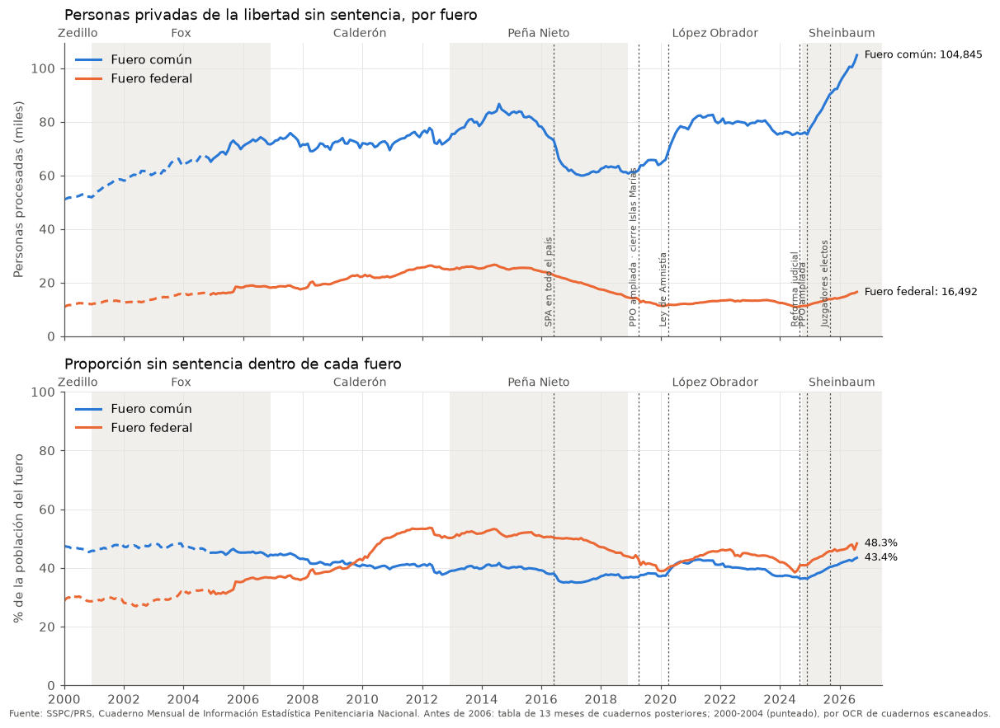

---

## Índice

1. [Fuentes](#1-fuentes)
2. [Cobertura y épocas de formato](#2-cobertura-y-épocas-de-formato)
3. [Arquitectura del pipeline](#3-arquitectura-del-pipeline)
4. [Modelo de datos](#4-modelo-de-datos)
5. [Conceptos y armonización](#5-conceptos-y-armonización)
6. [Validación](#6-validación)
7. [Periodos de análisis e hitos](#7-periodos-de-análisis-e-hitos)
8. [Gráficas tempranas](#8-gráficas-tempranas)
9. [Estructura del repositorio y entorno](#9-estructura-del-repositorio-y-entorno)
10. [Registro de decisiones](#10-registro-de-decisiones)
11. [Hoja de ruta](#11-hoja-de-ruta)
12. [Trampas conocidas](#12-trampas-conocidas)
13. [Glosario](#13-glosario)
14. [Bitácora](#14-bitácora)
15. [Diferencias con los censos de INEGI](#15-diferencias-con-los-censos-de-inegi)
16. [PDFs escaneados (2000–2005): estado y plan](#16-pdfs-escaneados-20002005-estado-y-plan)
17. [Validación externa con Intersecta y la pista de 1991–1999](#17-validación-externa-con-intersecta-y-la-pista-de-19911999)
18. [Así se ven los PDFs: los problemas que hubo que resolver](#18-así-se-ven-los-pdfs-los-problemas-que-hubo-que-resolver)

---

## 1. Fuentes

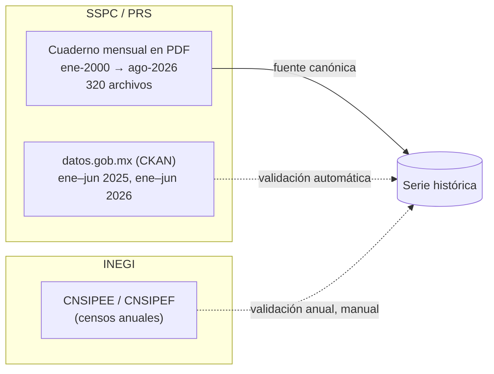

### 1.1 PDFs (fuente canónica)

- Página índice: <https://www.gob.mx/prevencionyreinsercion/documentos/cuaderno-mensual-de-informacion-estadistica-penitenciaria-nacional-359620?idiom=es>
- La página índice enlaza una página por año o grupo de años: `…/cuaderno-mensual-de-informacion-estadistica-penitenciaria-nacional-{2026,2025,2024,2023,2017-2019,2015-2016,2013-2014,2012,…,2000}`. La página **sin sufijo** corresponde a 2020‑2022.
- Los archivos viven en `https://www.gob.mx/cms/uploads/attachment/file/<id>/<nombre>.pdf`. Los `<id>` **no son secuenciales**, así que hay que obtener los enlaces de cada página anual.
- **Desde oct‑2026 las páginas HTML tienen un desafío anti‑bots**, así que no se pueden raspar con `curl`. Las 320 ligas se tomaron desde el navegador y viven en `data/enlaces.csv`. Los PDFs sí bajan con `curl` y un User‑Agent de navegador.
- Nombres irregulares que el descargador tiene que aceptar: `2000_01_CE.pdf` (2000‑2005), `CE_YYYY_MM.pdf`, `CE_2020_ENERO.pdf`, `CE_2020_SEPT.pdf`, `CE_10_2021.pdf`, `CE_12_2019.pdf`, `CUADERNO_ESTAD_STICO_SEPTIEMBRE_2025.pdf` y extensión `.PDF` (2007‑2008). **El periodo se toma de la página y del texto del PDF, no del nombre del archivo.**
- **Hueco conocido: dic‑2003.** La página de 2003 enlaza por error `CE_2023_12.pdf` (file id 902713).

### 1.2 Datos abiertos (validación)

- Organización `prs` en datos.gob.mx. Hay 19 datasets.
- API CKAN:
  - `https://www.datos.gob.mx/api/3/action/package_search?fq=organization:prs&rows=200`
  - `https://www.datos.gob.mx/api/3/action/datastore_search?resource_id=<id>&limit=1000`
- **Requiere un User‑Agent de navegador.** Sin él, Akamai responde 403.
- Los enlaces CSV directos (`repodatos.atdt.gob.mx/api_update/prs/...`) **responden 403** siempre. Hay que usar `datastore_search`.

| Serie | Meses | Recursos | Notas |
|---|---|---|---|
| Información estadística penitenciaria nacional (mes, 2025) | ene–jun 2025 | 31 CSV | archivos `NN_<tabla>_<mes>25.csv`; `fecha` = fecha de corte |
| Población penitenciaria vulnerable y de origen extranjero (mes, 2025) | ene–jun 2025 | 21 CSV | fuera del alcance de la fase 1 |
| Cuaderno Mensual Estadístico Penitenciario (mes, 2026) | ene–jun 2026 | 52–54 CSV | tablas extra (indígenas, LGBTTTIQ+, extranjeros, discapacidad…); `fecha` = **fecha de carga**, no de corte |

Las tablas que interesan tienen los mismos nombres de columna en 2025 y 2026:

| Recurso | Nivel | Contenido |
|---|---|---|
| `fue_sjur_sex_ent` | entidad (32 estados + 14 CEFERESO = 46 filas) | fuero × procesadas/sentenciadas × hombres/mujeres. En 2026 aparece mal titulado como "ingresos y egresos". |
| `fue_sjur_sex_centro1` | centro (~275 filas) | `estado`, `centro`, `espacios`, sobrepoblación, fuero × situación × sexo |
| `sobrepob_ent` | entidad | `numero_centros`, `espacios`, `poblacion`, sobrepoblación |
| `fue_sjur_var_mensual` | nacional, últimos 13 meses | procesadas/sentenciadas por fuero y su variación |

La copia local de los metadatos y de muestras de `datastore_search` está en `data/raw/ckan/`.

### 1.2b Población de referencia (CONAPO)

- Para las tasas por 100 mil habitantes se usan las **proyecciones de población de CONAPO** de [datos.gob.mx](https://www.datos.gob.mx/dataset/proyecciones-de-poblacion/resource/e9160552-769b-41ee-88d1-afc765552608) (`pobproy_inddemo.csv`): población a mitad de año por municipio, sexo y grandes grupos de edad, de 1990 a 2040.
- `conapo.py` la baja con `datastore_search`, porque el CSV directo da 403, y la agrega por entidad y año en `data/processed/poblacion_conapo.csv`.
- **Denominador: población de 15 años o más.** Es el grupo publicado más cercano a la población adulta, porque el recurso no trae 18+. La página interpola linealmente entre mitades de año para cada mes.

### 1.3 INEGI (validación anual)

- CNSIPEE, centros estatales: <https://www.inegi.org.mx/programas/cnsipee/>
- CNSIPEF, centros federales: <https://www.inegi.org.mx/contenidos/programas/cnsipef/2025/doc/cnsipef_2025_m2.pdf>
- Informes CTEISP del SNIEG, que usan el Cuaderno para sus Indicadores Clave: <https://www.snieg.mx/Documentos/Gobierno/Inf_semestral/2023/inf_cte_isipe2023.pdf>

No se encontró ninguna compilación previa de esta serie (GitHub, México Evalúa, Documenta, Asilegal).

---

## 2. Cobertura y épocas de formato

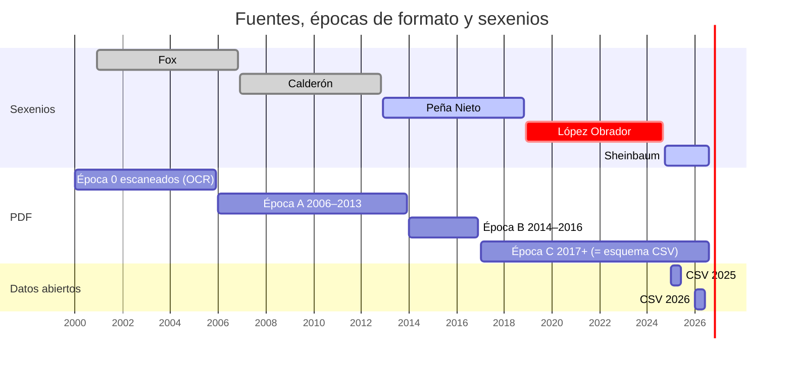

| Época | Años | Texto | Rasgos | Fase |
|---|---|---|---|---|
| **0** | 2000‑2005 | **escaneado, sin capa de texto** | requiere OCR | 5 (posible uso de Colab con GPU) |
| **A** | 2006‑2013 (43‑54 pp.) | sí | tabla por entidad "según fuero, situación jurídica y sexo" con los renglones **ordenados por tamaño** y el nombre de la entidad repetido a la derecha de las cifras (ver [§12](#12-trampas-conocidas)). Ya hay tablas por centro ("Capacidad, sobrepoblación y población… por entidad federativa y centro"). Habla de "Internos" y "Procesados". | 3 |
| **B** | 2014‑2016 (58‑61 pp.) | sí | mismo contenido que la C, con variantes de títulos y renglones (ver [§12](#12-trampas-conocidas)); dice "Capacidad" e "Instituciones penitenciarias federales" hasta 2016 | 2 |
| **C** | 2017/2019‑2026 | sí | "Población privada de la libertad", "Personas procesadas", "Espacios". Tabla de origen por cada CEFERESO. Su estructura equivale a los CSV de 2026. | 1 |

Todas las épocas traen fuero común/federal, sexo y procesados/sentenciados. Todas incluyen una **tabla nacional de 13 meses**, de modo que cada cuaderno sirve para revisar los 12 anteriores.

Los límites entre épocas (2013/2014, 2016/2017) son aproximados. El parser debe **detectar la época por el texto** (encabezados), no por el año.

---

## 3. Arquitectura del pipeline

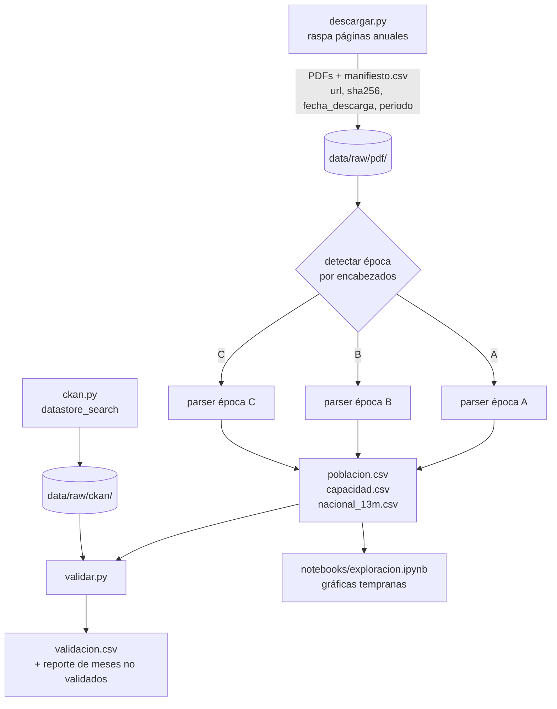

Principios:

- **Un solo extractor por época, aplicado a todos los meses.** No hay un pipeline aparte para los CSV: los CSV solo validan.
- **pdfplumber por coordenadas**, no `pdftotext -layout`. Este último **desalinea las celdas vacías**: en el cuaderno de ago‑2026 los CEFERESO sin mujeres "corren" sus cifras a otra columna. `pdftotext` sigue sirviendo para *buscar* páginas y encabezados.
- Los nombres de entidades y centros **se guardan en crudo**. La armonización de centros es una fase posterior.
- El proceso es idempotente: volver a correrlo sobre los mismos PDFs produce exactamente los mismos CSV.
- Actualización mensual: se corre `descargar.py` y el resto a mano cuando sale un cuaderno nuevo. No hay automatización por ahora.

---

## 4. Modelo de datos

Formato **largo**. **No se guardan totales**: se calculan, y se usan para validar.

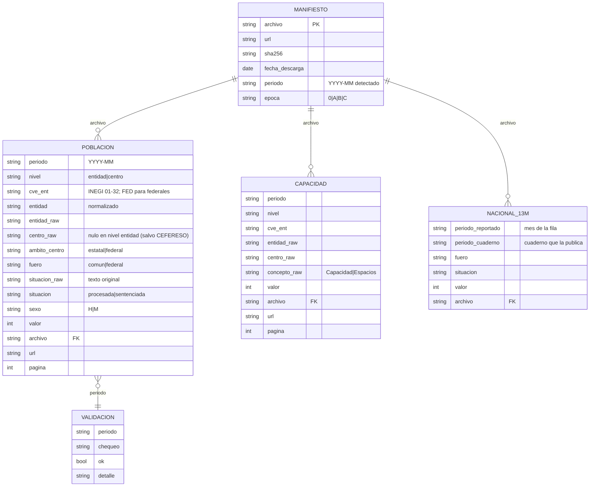

Notas:

- `url` es la URL del PDF de origen, repetida en cada fila a propósito, para que cualquier cifra se pueda rastrear sin hacer joins.
- **Centros federales.** En `nivel=entidad`, cada CEFERESO es una fila con `cve_ent=FED`, `entidad="Centros federales"`, `ambito_centro=federal` y `centro_raw=<nombre>`. Así lo publica la fuente. Los CEFERESO **no se reparten por estado** porque su naturaleza es distinta.
- **Celdas vacías.** Una celda vacía en la fuente (por ejemplo, mujeres en un centro varonil) **no se escribe como fila**. Una fila con `valor=0` significa que la fuente publicó un 0.
- `nacional_13m` se guarda tal como lo publica cada cuaderno, incluso duplicado, para que sirva de testigo: un mismo mes aparece en 13 cuadernos.

---

## 5. Conceptos y armonización

### 5.1 Fuero vs. ámbito del centro (dos dimensiones distintas)

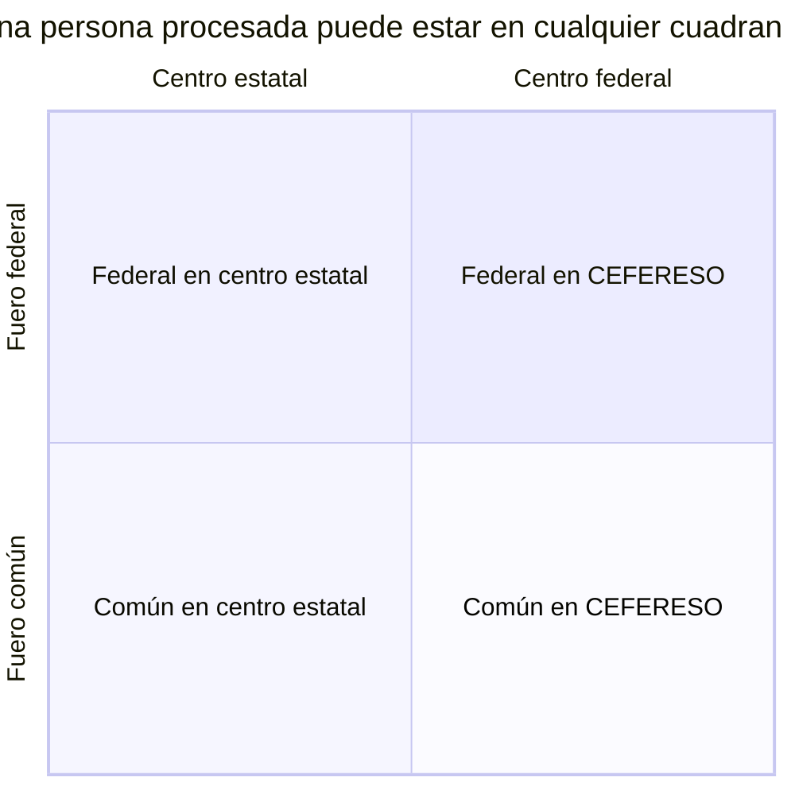

- `fuero` describe el delito o la autoridad que procesa.
- `ambito_centro` describe quién administra la prisión.
- En los centros estatales hay personas del fuero federal (por ejemplo, el CRS para Varones de Aguascalientes, jun‑2026: 106 procesados federales), y en los CEFERESO hay personas del fuero común.
- **"Procesados federales" es ambiguo.** Cada gráfica tiene que decir qué dimensión usa.

### 5.2 Situación jurídica

- La fuente usa "procesados/procesadas" y "sentenciados/sentenciadas". La expresión "sin sentencia" no aparece en ninguna edición revisada.
- `situacion_raw` guarda el texto tal cual. `situacion ∈ {procesada, sentenciada}` es la armonizada.
- En este proyecto, **sin sentencia = `situacion == "procesada"`**.
- La tabla de equivalencias se documenta en el código del parser. Cualquier etiqueta nueva **hace fallar** la extracción en lugar de clasificarse en silencio.

### 5.3 Capacidad

- Antes de 2017 se llama "Capacidad"; después, "Espacios". Se guarda `concepto_raw` y se tratan como el mismo concepto.
- La sobrepoblación **se calcula, no se copia**: población − espacios, y (población − espacios) / espacios.
- Motivo: los CSV cambian de unidad entre 2025 (fracción, 0.2476) y 2026 (porcentaje, 39).

### 5.4 Entidades

- `cve_ent` sigue el catálogo INEGI.
- `entidad_raw` conserva la grafía original ("Estado de Mexico" o "Estado de México", "Distrito Federal" o "Ciudad de México").

---

## 6. Validación

Los meses que no pasan **se guardan, se marcan y se reportan**. Nunca se descartan en silencio. Una corrección manual solo se acepta con una nota que diga por qué.

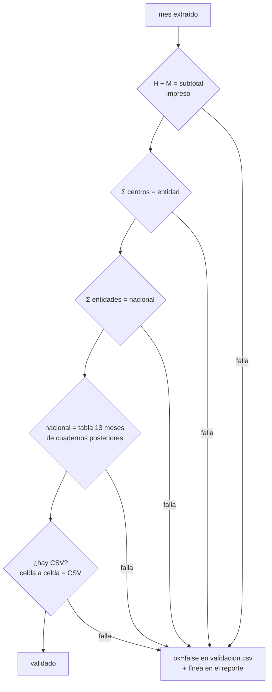

| Chequeo | Aplica a | Tolerancia |
|---|---|---|
| `suma_sexo` | todas las filas con subtotal impreso | 0 |
| `centros_vs_entidad` | meses con tabla por centro | 0; cualquier diferencia se reporta |
| `entidades_vs_nacional` | todos | 0 |
| `nacional_vs_13m` | todos los meses que aparezcan en un cuaderno posterior | 0; las revisiones retroactivas se reportan aparte |
| `pdf_vs_csv` | ene–jun 2025, ene–jun 2026 | 0 |
| `inegi_anual` | cortes anuales | sin tolerancia: es otra fuente; las diferencias se reportan en [§15](#15-diferencias-con-los-censos-de-inegi) |

---

## 7. Periodos de análisis e hitos

| Periodo | Desde | Hasta | Rol |
|---|---|---|---|
| Calderón | 2006‑12 | 2012‑11 | contexto histórico |
| **Peña Nieto** | **2012‑12** | **2018‑11** | **línea de base de comparación** (sexenio completo) |
| **López Obrador** | **2018‑12** | **2024‑09** | **núcleo de la historia** |
| Sheinbaum | 2024‑10 | en curso | continuidad |

Hitos que se marcan **explícitamente** en las gráficas. Las publicaciones en el DOF se verificaron el 2026‑10‑14.

| Fecha | Hito | Fuente | Por qué importa |
|---|---|---|---|
| 2008‑06‑18 | Reforma constitucional en seguridad y justicia penal (sistema acusatorio) | [DOF 5046978](https://dof.gob.mx/nota_detalle.php?codigo=5046978&fecha=18/06/2008) | inicia la transición; el transitorio 2.º da un plazo de 8 años |
| **2016‑06‑18** | **Vence el plazo: Sistema Penal Acusatorio vigente en todo el país** | transitorio 2.º del decreto de 2008 y el CNPP ([DOF 05/03/2014](https://dof.gob.mx/nota_detalle.php?codigo=5334903&fecha=05/03/2014)) | **corte metodológico dentro del sexenio de Peña Nieto**: antes de esta fecha, buena parte de los procesados viene del sistema mixto. La comparación contra AMLO tiene que mostrarlo. |
| 2019‑03 | Cierre del complejo penitenciario Islas Marías (traslados del 8 al 9 de marzo) | anuncio presidencial y prensa; no es una reforma publicada en el DOF | cambia el conjunto de CEFERESO |
| 2019‑04‑12 | Reforma al art. 19: se amplía el catálogo de prisión preventiva oficiosa | [DOF 5557700](https://dof.gob.mx/nota_detalle.php?codigo=5557700&fecha=12/04/2019) | hipótesis central del aumento de procesados |
| 2020‑04‑22 | Ley de Amnistía (y COVID‑19 en el mismo periodo) | [DOF 5592105](https://dof.gob.mx/nota_detalle.php?codigo=5592105&fecha=22/04/2020) | posibles caídas o choques |
| 2024‑09‑15 | Reforma al Poder Judicial: elección de personas juzgadoras | [DOF 5738985](https://dof.gob.mx/nota_detalle.php?codigo=5738985&fecha=15/09/2024) (edición vespertina) | cambia a los jueces que resuelven los procesos. La primera elección judicial fue el 2025‑06‑01 y las personas electas asumieron el cargo el 2025‑09‑01; también se marcan esas dos fechas |
| 2024‑12‑31 | Nueva ampliación de la prisión preventiva oficiosa (extorsión, fentanilo y drogas sintéticas, contrabando, facturas falsas) | [DOF 5746525](https://dof.gob.mx/nota_detalle.php?codigo=5746525&fecha=31/12/2024) (edición vespertina) | relevante para el periodo de Sheinbaum |

---

## 8. Gráficas tempranas

Se hacen en un notebook con matplotlib. Cuando la historia esté armada se pasa a una página interactiva.

1. **Procesados nacionales por mes**, en número absoluto y como % de la población total, separados por fuero. Incluye bandas de sexenio y líneas en los hitos de §7. Empieza en 2000: 2000‑2004 sale de `nacional_13m_ocr.csv` (OCR, en punteado), 2005 de la tabla de 13 meses de los cuadernos de 2006 y desde 2006 de la tabla por entidad. Si un mes viene en varios cuadernos, manda el más reciente.
2. **% de procesados por entidad**, como heatmap entidad × mes o small multiples. Los centros federales van como su propia "entidad".
3. **CEFERESO**: procesados por centro a lo largo del tiempo, con nombres sin armonizar.

---

## 9. Estructura del repositorio y entorno

```
cuaderno_pen/
├── README.md
├── .gitignore              # excluye data/raw/
├── descargar.py            # data/enlaces.csv → PDFs + manifiesto
├── extraer.py              # PDFs → poblacion/capacidad/nacional_13m/impresos (épocas A, B y C, 2006+)
├── ocr13.py                # OCR de la tabla de 13 meses, ene‑2001 a ene‑2005 → nacional_13m_ocr.csv
├── ckan.py                 # datastore_search → data/raw/ckan/<AAAA-MM>/
├── validar.py              # chequeos de §6 → validacion.csv + reporte_validacion.md
├── notebooks/
│   ├── exploracion.py      # fuente (celdas # %%)
│   └── exploracion.ipynb   # versión ejecutada
├── graficas/               # PNG de las gráficas tempranas
└── data/
    ├── enlaces.csv         # versionado: periodo → URL de cada PDF (320 ligas)
    ├── raw/                # NO versionado (~1.1 GB de PDFs)
    │   ├── pdf/            # CE_AAAA-MM.pdf
    │   ├── ckan/
    │   ├── muestras/       # 12 PDFs de muestra + .txt (de exploración)
    │   └── manifiesto.csv
    └── processed/          # versionado: CSV pequeños
        ├── poblacion.csv
        ├── capacidad.csv
        ├── nacional_13m.csv
        ├── nacional_13m_ocr.csv  # 2000‑01 a 2005‑01, por OCR (mismas columnas)
        ├── impresos.csv    # subtotales/totales impresos, solo para validar
        ├── errores.csv     # meses que el extractor no pudo leer
        ├── validacion.csv
        └── reporte_validacion.md
```

**Correr todo:**

```bash
conda activate cuaderno_pen && python descargar.py && python ckan.py && python extraer.py 2006-01 && python validar.py && python notebooks/exploracion.py && python conapo.py && python pagina.py
```

**Mes nuevo:** agregar su renglón a `data/enlaces.csv` (periodo, URL del PDF) y volver a correr la cadena. Las páginas HTML de gob.mx tienen un desafío anti‑bots, así que las ligas se toman a mano desde el navegador. Los PDFs sí bajan directo.

**Entorno:** se crea un conda env propio, `cuaderno_pen`, con `pdfplumber`, `pandas`, `matplotlib`, `requests` y `jupyter`. No se reutiliza `votaciones_corte`, para no romper otro proyecto. `pdftotext` (mingw) ya está instalado.

```bash
conda create -n cuaderno_pen -c conda-forge python=3.12 pdfplumber pandas matplotlib requests jupyter
conda activate cuaderno_pen && pip install rapidocr_onnxruntime   # sólo para ocr13.py
```

**Colab:** no hace falta para las fases 1‑4, porque la extracción local tarda minutos. Se reserva para el OCR de 2000‑2005.

---

## 10. Registro de decisiones

| # | Tema | Decisión | Motivo |
|---|---|---|---|
| D1 | Sexenios | AMLO como núcleo, Peña Nieto completo como base y Sheinbaum como continuidad | comparar sexenios completos; marcar el corte de jun‑2016 |
| D2 | Alcance fase 1 | situación jurídica × fuero × sexo + capacidad | lo mínimo para la historia. **Todas las variables** del cuaderno quedan para después y el esquema largo lo permite. |
| D3 | Nivel geográfico | **entidad y centro** | los CEFERESO solo se ven bien por centro; los nombres de centro van en crudo |
| D4 | Frecuencia | mensual | ve choques puntuales; el costo marginal por mes es casi cero |
| D5 | "Sin sentencia" | `situacion_raw` + `situacion` armonizada | trazabilidad ante cuestionamientos |
| D6 | Producto | base + script reproducible + gráficas tempranas | — |
| D7 | Herramientas | Python; pdfplumber en un env propio | `pdftotext -layout` desalinea celdas vacías |
| D8 | Fuente canónica | **PDF en todos los meses**; CSV solo valida | un solo pipeline; cubre jul–dic 2025 y los meses sin CSV |
| D9 | Inicio | 2006; 2000‑2005 (OCR) después | todo lo de 2006 en adelante es texto |
| D10 | Centros federales | entidad aparte (`FED`), sin repartir por estado | naturaleza distinta |
| D11 | Línea de base | sexenio completo de Peña Nieto, con el corte de 2016‑06 explícito | comparación completa sin ocultar el cambio de sistema |
| D12 | Fuero vs. ámbito | dos columnas | hay presos comunes en centros federales y federales en centros estatales |
| D13 | Esquema | formato largo, sin totales; con `archivo`, `url` y `pagina` | trazabilidad y tolerancia a cambios de formato |
| D14 | Meses que fallan | se guardan, se marcan y se reportan | un hueco es peor que un dato marcado |
| D15 | Orden | época C → B → A → OCR | gráficas tempranas del núcleo; validable contra CSV |
| D16 | Gráficas | notebook primero, página interactiva después | — |
| D17 | Repo | git; `data/raw` fuera de git con manifiesto `sha256`; salidas en CSV | reproducibilidad sin cargar 1 GB en git |

---

## 11. Hoja de ruta

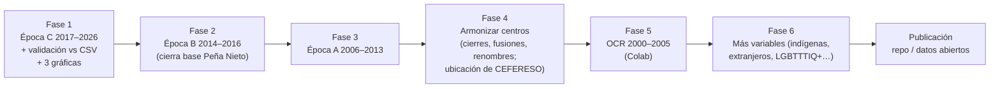

Para la base de Peña Nieto (dic‑2012 a nov‑2018) se necesitan las épocas A (2012‑2013), B (2014‑2016) y C (2017‑2018). Con la fase 3 terminada, los sexenios de Calderón y Peña Nieto están completos a nivel entidad y centro.

---

## 12. Trampas conocidas

- **Encoding.** Los `.txt` de `pdftotext` salen en Latin‑1 o cp1252: "Michoac�n". Hay que leer con el encoding correcto o pasar `-enc UTF-8`.
- **Columnas desalineadas.** `pdftotext -layout` desalinea las celdas vacías (CEFERESO varoniles o femeniles). Por eso se usa pdfplumber.
- **Variantes de la época A (2006‑2013)**, detectadas por el texto y no por la fecha:
  - **Nombre repetido a la derecha.** La tabla por entidad trae el nombre de la entidad dos veces: a la izquierda con su lugar por tamaño ("1 DISTRITO FEDERAL") y a la derecha de las cifras ("DISTRITO FEDERAL 1"). `pdftotext -layout` intercala los dos bloques; con pdfplumber los renglones salen bien, pero el lugar de la derecha contaría como columna. Por eso cada página se recorta (`page.crop`) donde empieza la primera palabra con letras después de un renglón de cifras, y se quita el lugar del inicio de la etiqueta.
  - **Orden por tamaño.** Los renglones van de la entidad más poblada a la menos, así que un centro federal (Islas Marías) puede venir antes que un estado chico (Tlaxcala, 2006). Un renglón cuyo nombre es un estado siempre es estatal.
  - **2007: la tabla no cabe en una hoja.** El % final, o solo el nombre repetido, pasa a la página siguiente. Esa hoja se descarta (no tiene renglones con 10 o más cifras) y se acepta la variante de 21 columnas.
  - **"######"**: celdas desbordadas de Excel en el subtotal de sentenciados del renglón TOTAL (2008) y en la tabla de 13 meses. Cuentan para ubicar columnas pero no son cifras. Cuando falta un total impreso, `entidades_vs_nacional` usa los subtotales si los hay y `nacional_vs_13m` cubre el resto.
  - **Fechas y títulos.** "Enero de 2006" (con "de"); la tabla de 13 meses se titula "…e incremento mensual" hasta 2010; en algunos meses de 2010 el título de la tabla por entidad no trae el mes.
  - **Notas al pie pegadas al nombre** del estado en la tabla por centro: "CHIAPAS**", "SAN LUIS POTO*S*Í", "PUEBLA (3)", "AGUASCALIENTES 2", "4 2 GUANAJUATO".
  - **Escalas distintas.** 2012‑04 trae páginas de 2,263 pt de ancho (el límite etiqueta/cifras se escala) y en 2010‑10 la página de los centros federales está a otra escala que las demás, así que las columnas de la tabla por centro se ubican página por página.
  - **Centros federales:** "Colonia Penal Federal Islas Marías" y "Cefereso 2 Puente Grande", sin renglón de grupo en la tabla por centro.
- **Fechas en los CSV.** En 2026, `fecha` es el timestamp de carga. El periodo se toma del nombre del dataset.
- **Unidades en los CSV.** `sobrepoblacion_relativa` viene como fracción en 2025 y como % en 2026. Los `_prct` son strings en 2025.
- **Recurso mal titulado.** En 2026, `fue_sjur_sex_ent` aparece titulado como "ingresos y egresos".
- **Revisiones retroactivas.** La tabla de 13 meses puede corregir meses anteriores. Las diferencias se reportan, no se "arreglan".
- **Variantes dentro de la época C:**
  - 2017‑2019: la tabla por centro no trae la columna de % del fuero común, y los centros federales aparecen sin renglón de grupo.
  - 2020‑2022: la tabla por entidad no trae renglón "Subtotal" antes de los CEFERESO, y agrega "Total del mes de <mes anterior>".

  El extractor acepta las dos variantes de columnas y reconoce a los centros federales por su nombre (`CEFERESO`, `CEFEREPSI`, `Centro Penitenciario Federal`, `CPS`…).
- **Variantes de la época B (2014‑2016)**, todas detectadas por el texto y no por la fecha:
  - La tabla por centro se titula "**Capacidad**, sobrepoblación y población…" hasta jun‑2016 y "Espacios, …" desde jul‑2016. `concepto_raw` guarda cuál de las dos.
  - De jul‑2014 a jun‑2016 los títulos dicen "…por entidad federativa **e institución penitenciaria federal**" en lugar de "…y centro penitenciario", y las fichas por CEFERESO dicen "en las instituciones penitenciarias federales". El renglón de grupo federal en la tabla por centro es "Instituciones Penitenciarias Federales".
  - Hasta 2015 la entidad es "**Distrito Federal**": es un estado, no un grupo federal.
  - La tabla por entidad trae % tras cada subtotal (22 columnas, como ene–jun 2017) y no tiene renglón "Subtotal". Cierra con "Total del mes de <mes>" y "Total del mes de <mes anterior>".
  - **Nov‑2016** cierra los estados con un "Total", pone el encabezado "CENTROS PENTENCIARIOS FEDERALES" (sic), lista los CEFERESO, cierra con otro "Total" y luego "Total del mes". Los dos primeros "Total" se tratan como subtotales. CEFERESO 3 Noreste aparece sin cifras.
  - Tabla de 13 meses: "Jul" partido en "Ju" + "l" y el renglón de jul‑2013 desfasado (jul‑2014), y "Aug" en inglés (feb‑2016).
- **Nombres sueltos que no son del renglón vecino.** Un renglón con solo un nombre que empieza con `CEFERESO` (un centro sin cifras) o el encabezado de centros federales no se pega a otro renglón. Antes se pegaba: en ene–abr 2017, "CEFERESO No. 3 Noreste" quedaba unido a CEFEREPSI o a CEFERESO 4.
- **Pie de página.** El número de página comparte renglón con "Elaborado por…", así que se descartan los renglones de pie (Fuente, Nota, Elaborado).
- **Hueco de dic‑2003** (época 0, no afecta a las fases 1‑4).
- **Conjunto de CEFERESO cambiante.** Hubo cierres (Islas Marías, entre otros) y aperturas de CPS privados desde ~2012. Por eso `centro_raw` va sin armonizar.

---

## 13. Glosario

| Término | Significado |
|---|---|
| Procesada/o | persona privada de la libertad **sin sentencia** (prisión preventiva) |
| Sentenciada/o | persona con sentencia condenatoria |
| Fuero común / federal | competencia estatal o federal sobre el delito |
| CEFERESO | Centro Federal de Readaptación Social |
| CPS | Centro Penitenciario Federal operado bajo contrato de prestación de servicios (privado) |
| CRS / CERESO | centro (estatal) de reinserción o readaptación social |
| PPO | prisión preventiva oficiosa (art. 19 constitucional) |
| SJPA / SPA | sistema de justicia penal acusatorio |
| PRS | Prevención y Readaptación Social (órgano de la SSPC que publica el cuaderno) |

---

## 14. Bitácora

### Fase 1: época C, 2017‑2026

**Fecha:** 2026‑10‑14. **Duración total:** ~3 h 10 min de trabajo continuo, de las ~11:15 (ligas y descarga) a las ~14:25 (validación limpia y notebook).

| Etapa | Tiempo aprox. |
|---|---|
| Ligas de las 21 páginas anuales (con navegador, por el desafío anti‑bots) | 5 min |
| Descarga de 319 PDFs (1.1 GB) | 4 min |
| CSV de datos abiertos, 12 meses × 4 tablas (`ckan.py`) | 2 min |
| Extractor: primera versión y pruebas con 3 muestras (2019, 2022, 2026) | 30 min |
| Corridas completas de 2017‑2026 y correcciones entre una y otra | ~2 h 15 min |
| Validación, gráficas, notebook, README | 15 min |

**Corridas completas del extractor sobre 2017‑2026:** 7 (5 terminadas y 2 interrumpidas a propósito para meter una corrección). Cada corrida tarda 25–35 min.

| # | Resultado | Qué se corrigió después |
|---|---|---|
| 1 | 52 de 116 meses con error | se tomaba la página del **índice** como tabla; el límite etiqueta/cifras era fijo; ene–jun 2017 trae % tras cada subtotal (22 col.); 2020‑2021 parten la tabla por entidad en 2 páginas con columnas distintas |
| 2 | interrumpida | ene–jun 2017: excluir páginas "por lugar de origen" de cada CEFERESO |
| 3 | interrumpida | cifras sueltas o de notas al pie creaban columnas falsas: grupos de < 5 % de los renglones no cuentan como columna |
| 4 | 24 meses con error de extracción y 66 con algún chequeo fallido | tabla de 13 meses: renglón "Incremento" de más o mes del cuaderno de menos, y ahora no aborta el mes; variante 2021 con % solo tras procesadas (18 col.); sangría relativa para renglones de grupo; validador: nombres largos/cortos de entidad y CSV con *mojibake* |
| 5 | 3 errores y 17 meses con falla | renglones de cifras sin etiqueta (nombre de centro partido arriba y abajo); total ilegible (2017‑04) o no impreso (2022‑04) en el validador |
| 6 | 3 errores y 2 meses con falla | 2021‑02 sin columna TOTAL en la tabla por centro (se elige la variante según dónde caen los "%"); entidades centradas: grupo = nombre de estado; "CENTRO PENITENCIARIO FEDERAL" en singular (2017); nombres de centro que rebasan el límite ("…San Miguel de Allende") |
| 7 | **3 errores (PDFs incompletos) y 0 fallas** | — |

**Resultado final** (`data/processed/reporte_validacion.md`):

| chequeo | meses ok | meses con falla |
|---|---|---|
| suma_sexo | 113 | 0 |
| entidades_vs_nacional | 113 | 0 |
| centros_vs_entidad | 113 | 0 |
| nacional_vs_13m | 113 | 0 |
| pdf_vs_csv (celda a celda, entidad y centro) | 12 | 0 |
| extraccion | — | 3 (2019‑06, 2019‑07, 2019‑08: PDFs de 1–2 páginas) |

**Hallazgos y pendientes:**

- **Jun–ago 2019** no tienen tablas en el PDF publicado. A nivel nacional se cubren con la tabla de 13 meses de cuadernos posteriores (así lo hace la gráfica 1); a nivel entidad y centro quedan vacíos. Hay que buscar si PRS los publicó en otro lado.
- **Revisión retroactiva rara en el cuaderno de dic‑2017.** Su tabla de 13 meses reporta para ene–mar 2017 un fuero federal de ~9 mil procesados, contra ~20 mil en los cuadernos de esos meses. Parece un cambio de criterio (¿qué cuenta como "federal"?) y hay que investigarlo antes de comparar 2017 con años posteriores.
- Las demás revisiones retroactivas son de ±1 persona (2023‑2024).
- **Centros federales sin armonizar:** en la gráfica 3, CEFERESO 3 muestra un pico improbable en 2017. Las sumas validan, así que es una etiqueta de centro mal asignada y no una cifra mala. *Resuelto en la fase 2:* eran nombres pegados (ver §12).
- **Entorno en Windows:** correr con `conda activate cuaderno_pen`. Llamar al `python.exe` del entorno sin activarlo carga DLLs del Anaconda base y matplotlib se cae (código 0xc06d007f).

### Fase 2: época B, 2014‑2016

**Fecha:** 2026‑10‑14. **Duración total:** ~3 h 40 min, de las ~16:35 a las ~20:15. Casi todo fue tiempo de máquina: tres corridas completas de ~50 min.

| Etapa | Tiempo aprox. |
|---|---|
| Revisar títulos y columnas en 3 muestras (2014‑01, 2015‑07, 2016‑12) y agregar las primeras variantes | 15 min |
| Corridas de 2014‑2016 (36 meses, ~25 s por mes) y correcciones entre una y otra | ~55 min |
| Corridas completas de 2014‑2026 (152 meses) | ~2 h 35 min |
| Validación, gráficas, README | 10 min |

**Corridas:** 3 de 2014‑2016 (a una carpeta temporal) y 3 completas de 2014‑2026.

| # | Alcance | Resultado | Qué se corrigió después |
|---|---|---|---|
| 1 | 2014‑2016 | 24 meses sin tabla por centro | títulos "Capacidad, …" y "…e institución penitenciaria federal"; excluir las fichas "en las instituciones penitenciarias federales" de la tabla por entidad |
| 2 | 2014‑2016 | 0 errores de lectura, 34 meses con falla en `centros_vs_entidad` y 2 sin tabla de 13 meses | "Distrito Federal" se tomaba como grupo federal; grupo "Instituciones Penitenciarias Federales"; "Ju l" y "Aug" en la tabla de 13 meses |
| 3 | 2014‑2016 | 1 mes con falla (2016‑11) | los "Total" intermedios de nov‑2016 se tratan como subtotales |
| 4 | 2014‑2026 | `validar.py` se cae: en 2025‑07 a 2026‑08 el "Total" final se tomaba como subtotal | un "Total" solo es subtotal si le sigue otro renglón |
| 5 | 2014‑2026 | 3 errores (PDFs incompletos de 2019) y 0 fallas | `concepto_raw` decía "Espacios" en meses con "Capacidad": el título trae un renglón vacío al inicio. Las cifras no cambian. |
| 6 | 2014‑2026 | **3 errores (PDFs incompletos de 2019) y 0 fallas**; "Capacidad" de 2014‑01 a 2016‑06 | — |

**Resultado final** (`data/processed/reporte_validacion.md`):

| chequeo | meses ok | meses con falla |
|---|---|---|
| suma_sexo | 149 | 0 |
| entidades_vs_nacional | 149 | 0 |
| centros_vs_entidad | 149 | 0 |
| nacional_vs_13m | 149 | 0 |
| pdf_vs_csv (celda a celda, entidad y centro) | 12 | 0 |
| extraccion | — | 3 (2019‑06, 2019‑07, 2019‑08: PDFs de 1–2 páginas) |

**Hallazgos:**

- **2014‑2016 no tiene revisiones retroactivas.** Cada cuaderno coincide con la tabla de 13 meses de los posteriores. Las 11 revisiones del reporte son de 2017 y 2023‑2024, igual que en la fase 1.
- **Efecto sobre 2017‑2026.** Las cifras no cambian. Hay dos mejoras: (1) se corrigieron los nombres de centro pegados de ene–abr 2017, que explicaban el pico de CEFERESO 3; (2) los cuadernos 2017‑03, 2017‑04, 2017‑08, 2018‑08 y 2018‑11 recuperan el renglón de su propio mes en la tabla de 13 meses (20 filas más en `nacional_13m.csv`).
- **CEFERESO 3 Noreste** deja de tener población a fines de 2016 (en nov‑2016 aparece sin cifras).
- **Velocidad:** ~20–30 s por cuaderno. pdfplumber lee palabra por palabra con coordenadas unas 60 páginas por PDF. La corrida completa de 152 meses tarda ~50 min.

### Fase 3: época A, 2006‑2013

**Fecha:** 2026‑10‑14 y 15. **Duración total:** ~3 h, de las ~22:40 a las ~01:45. Casi todo fue tiempo de máquina: dos corridas de 2006‑2013 (~45 min cada una) y, en paralelo con la segunda, una de 2014‑2026 (~1 h 30 min) para confirmar que nada cambió.

| Etapa | Tiempo aprox. |
|---|---|
| Revisar títulos, columnas y bloques en 4 muestras (2006‑01, 2008‑12, 2011‑06, 2013‑12) y agregar las primeras variantes | 25 min |
| Corrida 1 de 2006‑2013 (96 meses, ~30 s por mes) | 45 min |
| Correcciones con los errores de la corrida 1 | 20 min |
| Corrida 2 de 2006‑2013 y corrida de control de 2014‑2026, en paralelo | 1 h 30 min |
| 2012‑04 (tabla de 13 meses), validación, gráficas, página, README | 15 min |

**Corridas:**

| # | Alcance | Resultado | Qué se corrigió después |
|---|---|---|---|
| 0 | 4 muestras | sin tablas en 2006‑01; 24 columnas en la tabla por entidad; sumas por centro que no cuadran | "Enero **de** 2006"; recorte del nombre repetido a la derecha (`page.crop`) y del lugar por tamaño a la izquierda; "Colonia Penal" como centro federal; notas al pie pegadas al estado ("CHIAPAS**", "PUEBLA (3)"); tabla de 13 meses "…e incremento mensual" y celdas "######" |
| 1 | 2006‑2013 | 11 meses con error de extracción y 6 con falla en `centros_vs_entidad`; `entidades_vs_nacional` y `nacional_vs_13m` ya limpios | 2007: tabla partida en dos hojas (variante de 21 columnas; se descarta la hoja sin cifras) y página que no empieza en (0, 0); 2010: título sin mes y notas al pie numéricas ("AGUASCALIENTES 2", "4 2 GUANAJUATO"); 2008: "SAN LUIS POTO*S*Í"; 2012‑04: páginas de 2,263 pt; 2010‑10: página de centros federales a otra escala (columnas por página); 2006‑06: Tlaxcala después de Islas Marías |
| 2 | 2006‑2013 | 1 error (2012‑04 sin tabla de 13 meses: "ABRIL - 2011 ABRIL - 2012") y 2 meses con falla | se repitió solo 2012‑04 |
| 2b | 2014‑2026 | **idéntico byte a byte** a lo publicado (`poblacion`, `capacidad`, `nacional_13m`, `impresos`, `errores`) | — |

**Resultado final** (`data/processed/reporte_validacion.md`, 2006‑01 a 2026‑08):

| chequeo | meses ok | meses con falla |
|---|---|---|
| suma_sexo | 245 | 0 |
| entidades_vs_nacional | 245 | 0 |
| centros_vs_entidad | 243 | 2 (2012‑05, 2012‑06: defecto del PDF, ver abajo) |
| nacional_vs_13m | 245 | 0 |
| pdf_vs_csv (celda a celda, entidad y centro) | 12 | 0 |
| extraccion | — | 3 (2019‑06, 2019‑07, 2019‑08: PDFs de 1–2 páginas) |

**Hallazgos:**

- **Nayarit, may–jun 2012: el PDF no cuadra consigo mismo.** En la tabla por centro, el renglón del estado dice 1,237 (mayo) y 1,202 (junio) procesados del fuero común, igual que la tabla por entidad, pero la suma de sus propios centros da 1,226 y 1,188 (11 y 14 menos). Los subtotales impresos de cada centro sí cuadran con sus H y M. Se deja como falla reportada.
- **`entidades_vs_nacional` "no verificable" en sep–dic 2008:** el subtotal de sentenciados del renglón TOTAL viene como "######". El total nacional se confirma con la tabla de 13 meses (`nacional_vs_13m` limpio).
- **Revisiones retroactivas de 2011:** el cuaderno de abr‑2012 corrige abr‑2011 por ±2 personas, y los de may‑2012 en adelante corrigen oct‑2011 (59 procesados del fuero común) y nov‑2011 (±1). El resto de 2006‑2013 coincide.
- **Sobrepoblación:** la tabla por centro de 2006‑2013 no tiene renglón de grupo para los centros federales (como 2017‑2019), así que la capacidad a nivel "entidad" de los centros federales no existe en esos años; a nivel centro sí.
- **Corrección de paso en `FEDERAL`:** el patrón tenía un carácter de control (retroceso) en lugar de `` tras `CPS`. Se corrigió; 2014‑2026 no cambia.
- **Tamaño:** `poblacion.csv` pasa de 49 a 86 MB e `impresos.csv` de 40 a 69 MB. GitHub avisa arriba de 50 MB y rechaza arriba de 100 MB, así que la fase 5 (2000‑2005) ya no cabe sin comprimir o partir esos archivos.

### Velocidad del extractor

**Fecha:** 2026‑10‑15.

Un perfil de `extraer.py` sobre 2017‑03 mostró que casi todo el tiempo se iba en que pdfminer interpreta cada página completa (~0.7 s por página, 60 páginas) solo para leer su título. Recortar la franja superior no lo evita, porque la página se interpreta entera de todos modos. Se hicieron tres cambios:

- **Prefiltro con pypdfium2** (ya venía como dependencia de pdfplumber). Saca el texto de todas las páginas en ~1 s, y solo las páginas cuyo texto trae las claves del título pasan a pdfplumber.
- **PDFs en paralelo** (`ProcessPoolExecutor`, un proceso por núcleo). Los resultados se juntan en el orden del manifiesto.
- **Caché por mes** en `data/raw/cache/`. La llave es el sha256 del PDF más un hash de `extraer.py`; cualquier cambio al extractor invalida todo el caché. `--sin-cache` lo ignora.

| Corrida | Antes | Después |
|---|---|---|
| 1 mes (2017‑03) | 43 s | — |
| 6 meses (2017‑01 a 2017‑06), sin caché | ~4 min 20 s (estimado: 6 × 43 s) | 34 s |
| los mismos 6 meses, con caché | — | 3 s |

**Verificación:** cinco rangos (2007‑01 a 06, 2010‑07 a 12, 2012‑03 a 06, 2017‑01 a 06 y 2019‑05 a 09, este último con sus tres errores) son idénticos renglón por renglón a los CSV publicados. No se repitió la corrida completa de 2006‑2026; la próxima que se haga (por ejemplo, con un cuaderno nuevo) debe dar `git diff data/processed` vacío salvo el mes agregado.

### Fase 5, versión mínima: serie nacional 2000‑2005 por OCR

**Fecha:** 2026‑10‑15. **Duración:** ~2 h, casi todo en probar motores de OCR. Una corrida de `ocr13.py` tarda ~5 min (5 páginas).

Se hizo lo mínimo útil de §16: OCR de la tabla de 13 meses de los cuadernos de enero de 2001 a 2005. Esas tablas están en las páginas 9 (2001‑2004) y 7 (2005); en 2001‑2003 vienen acostadas. Cada tabla trae ene del año anterior a ene del año del cuaderno, así que salen 2000‑01 a 2005‑01: 61 meses × 4 combinaciones de fuero y situación jurídica = 244 cifras distintas (260 renglones, porque cada enero intermedio viene en dos cuadernos).

| Intento | Resultado |
|---|---|
| Tesseract 5.5 (`spa`), página completa | malo: el sombreado de puntos de las celdas y las líneas de la tabla dan basura |
| Tesseract con desenfoque + umbral, líneas borradas y sólo dígitos, por franja y por celda | mejor, pero confunde 8 con 3, pierde dígitos y no cuadra ninguna tabla |
| **RapidOCR** (modelos PaddleOCR en ONNX, CPU), página a ~200 dpi con desenfoque leve | casi perfecto en las cifras normales; los errores se concentran en los incrementos, que vienen en negritas |

Lo que hizo falta además (en `ocr13.py`):

- **Renglones trazados de izquierda a derecha.** El escaneo de 2002 viene combado: con una sola altura por renglón, un renglón se partía en dos.
- **Limpieza de lecturas:** basura pegada ("14,111.", '"12,913'), y "159.716" se lee como "159,716" (los porcentajes traen dos decimales). El año ("2000") se descarta.
- **Relectura de celdas.** Si un renglón no cuadra o le falta una cifra, cada celda de conteo se vuelve a leer sola, a 1.5× de resolución. Se acepta la única combinación de lecturas que cuadra; si hay cero o varias, el cuaderno falla.

**Validación:**

| chequeo | resultado |
|---|---|
| procesados + sentenciados = subtotal (cada fuero), común + federal = total, en los 65 renglones | 65 de 65 |
| eneros repetidos en dos cuadernos (2001‑01 a 2004‑01), leídos de escaneos distintos | 16 de 16 cifras idénticas |
| 2005‑01 contra la tabla de 13 meses de ene‑2006 (con texto) | 4 de 4 cifras idénticas |
| incremento absoluto impreso = diferencia entre renglones | 21 avisos de 420; todos en celdas en negritas mal leídas (por ejemplo "856-" por -938). Las sumas ya confirman los conteos, así que sólo se avisa |

**Pendiente:**

- ~~La gráfica y la página aún no usan `nacional_13m_ocr.csv`.~~ Hecho: la gráfica 1 y la página empiezan en 2000; 2000‑2004 va punteado y marcado como OCR (en la tabla de la página, con †). 2005 en adelante no cambió (mismas cifras en `docs/index.html`). El "punto más bajo" de la página pasa a ser enero de 2000.
- Tablas por entidad y por centro de 2000‑2005 (resto de §16), con el mismo método.
- Tesseract y `pytesseract` quedaron instalados en el env, aunque ya no se usan.

---

## 15. Diferencias con los censos de INEGI

Los censos penitenciarios de INEGI y el Cuaderno de PRS son **fuentes distintas**: los registros administrativos que cada entidad reporta a dos instituciones diferentes, con conceptos que no son idénticos. Aquí no se busca que cuadren, sino documentar cuánto y por qué difieren. La comparación es contra el **cuaderno de diciembre** de cada año, porque INEGI reporta el cierre del año (31 de diciembre).

**Fuentes INEGI:**
- CNGSPSPE 2018–2020 y CNSIPEE/CNSIPEF 2021–2024, en la gráfica 2 del [boletín CNSIPEE‑F 2024](https://inegi.org.mx/contenidos/saladeprensa/boletines/2024/CNSIPEE-F/CNSIPEE-F2024.pdf).
- CNSIPEF‑E 2026 (cierre 2024 y 2025), en la tabla 10 y la gráfica 8 del [reporte de resultados](https://www.inegi.org.mx/contenidos/saladeprensa/boletines/2026/cnispee/CNSIPEF-E2025_RR.pdf).

### Población privada de la libertad total y en centros federales

| Cierre | INEGI total | Cuaderno dic. | Diferencia | INEGI federal | Cuaderno federal | Dif. |
|---|---|---|---|---|---|---|
| 2017 | 201,903 | 204,617 | +2,714 (+1.3 %) | 19,904 | 19,899 | −5 |
| 2018 | 196,322 | 197,988 | +1,666 (+0.8 %) | 17,916 | 17,916 | 0 |
| 2019 | 198,805 | 200,936 | +2,131 (+1.1 %) | 17,271 | 17,271 | 0 |
| 2020 | 211,154 | 214,231 | +3,077 (+1.5 %) | 16,328 | 16,328 | 0 |
| 2021 | 220,419 | 222,369 | +1,950 (+0.9 %) | 16,060 | 16,060 | 0 |
| 2022 | 226,077 | 228,530 | +2,453 (+1.1 %) | 18,976 | 18,976 | 0 |
| 2023 | 233,277 | 231,905 | −1,372 (−0.6 %) | 20,852 | 20,851 | −1 |
| 2024 | 236,773 | 235,197 | −1,576 (−0.7 %) | 20,702 | 20,702 | 0 |
| 2025 | 231,436 | 256,127 | +24,691 (+10.7 %) | 20,411 | 20,411 | 0 |

- **Centros federales:** las dos fuentes coinciden prácticamente exacto todos los años. Todo indica que INEGI toma la cifra federal del mismo registro de PRS.
- **Centros estatales:** el Cuaderno trae entre 1,700 y 3,100 personas más que INEGI de 2017 a 2022, y entre 1,400 y 1,600 menos en 2023–2024. Esto pasa a pesar de que INEGI incluye además a los adolescentes en internamiento (1,274 en 2023 y 1,754 en 2025) y el Cuaderno no. Las causas probables son la fecha exacta de corte y la forma en que cada entidad responde a cada institución.
- **2025:** INEGI no incluye a la población adulta de los centros de Ciudad de México, que no entregó esa información. Si se quita Ciudad de México del Cuaderno (26,609 personas), quedan 229,518 contra 229,682 adultos de INEGI: una diferencia de −164.

### Personas sin sentencia

INEGI publica la cifra sin sentencia con detalle a partir del cierre de 2023. Antes solo aparece como porcentaje en gráficas de boletines, sin cifras legibles.

| Cierre | INEGI sin sentencia | Cuaderno procesadas (dic.) | Diferencia |
|---|---|---|---|
| 2023 | 86,984 (37.3 %) | 87,812 (37.9 %) | +828 |
| 2024 | ≈ 85,950 (36.3 %, cifra calculada con el % publicado) | 86,625 (36.8 %) | ≈ +675 |
| 2025 | 97,722 (42.2 %), sin adultos de Ciudad de México | 106,294; sin Ciudad de México, 98,332 | +610 sin Ciudad de México |

- **Los conceptos no son iguales.** INEGI separa "sin sentencia", "sentencia no definitiva" y "sentencia definitiva". En 2023 hubo 17,202 personas con sentencia no definitiva, que INEGI cuenta del lado *con sentencia*. El Cuaderno solo distingue procesadas y sentenciadas. Aun así, las dos cifras de "sin sentencia" quedan a menos de 1 % de distancia, lo que sugiere que el Cuaderno también clasifica como sentenciada a quien tiene una sentencia no definitiva.
- **Ciudad de México pesa en 2025.** El salto de INEGI de 36.3 % a 42.2 % entre 2024 y 2025 se da *sin* los adultos de Ciudad de México, que en el Cuaderno tienen una proporción de procesados (30 %) más baja que el promedio. La serie del Cuaderno no tiene ese hueco, así que es la mejor base para ver la tendencia nacional de 2025–2026.

---

## 16. PDFs escaneados (2000–2005): estado y plan

> **Estado (2026‑10‑15): versión mínima hecha.** La serie nacional por fuero y situación jurídica de 2000‑01 a 2005‑01 está en `data/processed/nacional_13m_ocr.csv` (`ocr13.py`, ver la bitácora en §14). Las tablas por entidad y por centro de 2000‑2005 siguen sin procesar. Esta sección documenta lo que se sabe de esos archivos y cómo se piensa extraerlos.

### Qué son

| Dato | Valor |
|---|---|
| PDFs | 71: ene‑2000 a dic‑2005, sin dic‑2003, cuya liga en gob.mx apunta por error al cuaderno de dic‑2023 |
| Páginas | 3,457 en total (43–53 por cuaderno) |
| Capa de texto | **ninguna**: `pdftotext` y pdfplumber devuelven 0 caracteres en los 71 |
| Contenido de cada página | una sola imagen escaneada de 1696 × 2176 px (≈ 200 dpi en carta) |
| Orientación | cambia: 2000 viene vertical; dic‑2005, horizontal (2176 × 1696) |

Cómo se verificó: se contaron los caracteres extraídos con `pdftotext` y con pdfplumber (las primeras tres páginas de cada uno de los 71 PDFs) y se inspeccionaron las imágenes de la primera página con pdfplumber (`page.images`). En 2006‑01, en cambio, `pdftotext` extrae unos 59 mil caracteres.

### Por qué no se ha hecho

- No hace falta para la pregunta central (sexenios de Peña Nieto, López Obrador y Sheinbaum), que se cubre con 2013 en adelante. La serie nacional ya llega hasta 2013 gracias a la tabla de 13 meses de ene‑2014.
- Es lo más caro del proyecto: OCR de unas 3,500 páginas de tablas numéricas, donde un dígito mal leído cambia la cifra sin que se note.
- Va después de la época A (2006‑2013, con texto), porque la serie de 2006 en adelante sirve para validar el empalme con 2005.

### Plan (fase 5)

1. **Localizar las páginas útiles antes de hacer OCR.** Por cuaderno solo se necesitan 2 o 3 páginas: la tabla por entidad según fuero, situación jurídica y sexo, la tabla de 13 meses y, si existe, la de capacidad. Se ubican con OCR rápido de los títulos (franja superior de cada página) y se procesa a fondo solo esa página.
2. **OCR por tabla, no por página corrida.** Se rota según la orientación y se binariza la imagen. Las celdas se reconocen con un motor que respete la estructura de tabla (Tesseract con `--psm 6` y lista blanca de dígitos y comas, o un modelo de visión que lea tablas). Aquí sí conviene Colab con GPU (decisión D9 y §9).
3. **La validación hace de corrector.** Se aplican los mismos chequeos de §6:
   - hombres + mujeres = subtotal;
   - suma de entidades = total nacional;
   - total nacional = tabla de 13 meses del cuaderno siguiente, que además da cada mes dos veces.

   Un mes que no cuadra se revisa contra la imagen, y la corrección se anota en un archivo de correcciones manuales con la página y el motivo. Nunca se edita el CSV a mano.
4. **Empalme 2005–2006.** El cuaderno de ene‑2006 (con texto) trae en su tabla de 13 meses los meses de 2005, así que sirve de prueba directa para el OCR de todo 2005.

Lo mínimo útil, si se quiere solo el total nacional: hacer OCR **solo de la tabla de 13 meses de los cuadernos de enero de 2001 a 2005** (5 páginas escaneadas) y leer la de enero de 2006, que trae texto. Con eso quedan 2000‑2005 completos a nivel nacional por fuero y situación jurídica.

---

## 17. Validación externa con Intersecta y la pista de 1991–1999

**Fuente:** Intersecta, *Con juicio o prejuicio. La prisión preventiva oficiosa en México*, septiembre de 2022 ([intersecta.org](https://www.intersecta.org)). Las gráficas de las páginas 4 y 5 dan, por año de 1991 a 2022, el **promedio anual** de personas privadas de la libertad y el porcentaje en prisión preventiva. El pie dice: "Fuente: Cuaderno mensual de información estadística penitenciaria nacional. El análisis está basado en el promedio anual de personas privadas de la libertad. Para 2022, se incluye el promedio de personas que estuvieron privadas de la libertad entre enero y junio."

Es un procesamiento independiente de la misma fuente, así que sirve para comprobar la extracción: si las dos cuentas parten de los mismos PDFs, los promedios deben coincidir.

### Comparación (promedio anual de la población total)

Se promediaron los meses de la tabla por entidad de cada año; en 2022, solo enero a junio, como Intersecta.

| Año | Este proyecto | Intersecta | Diferencia | % sin sentencia aquí | Intersecta |
|---|---|---|---|---|---|
| 2006 | 212,254 | 212,226 | +28 | 42.9 | 43 |
| 2007 | 216,087 | 216,087 | 0 | 42.5 | 43 |
| 2008 | 218,972 | 218,972 | 0 | 41.0 | 41 |
| 2009 | 226,890 | 226,890 | 0 | 41.3 | 41 |
| 2010 | 224,294 | 224,394 | −100 | 41.8 | 42 |
| 2011 | 227,206 | 227,205 | +1 | 43.2 | 43 |
| 2012 | 237,594 | 237,594 | 0 | 42.0 | 42 |
| 2013 | 246,071 | 246,071 | 0 | 42.2 | 42 |
| 2014 | 254,572 | 254,372 | +200 | 42.8 | 43 |
| 2015 | 254,323 | 254,323 | 0 | 42.1 | 42 |
| 2016 | 234,250 | 234,259 | −9 | 39.5 | 40 |
| 2017 | 210,214 | 210,274 | −60 | 38.1 | 38 |
| 2018 | 202,621 | 203,621 | −1,000 | 38.7 | 39 |
| 2019 | 200,438 | 200,705 | −267 | 38.1 | 38 |
| 2020 | 210,202 | 210,202 | 0 | 40.2 | 40 |
| 2021 | 220,717 | 220,717 | 0 | 42.6 | 43 |
| 2022 (ene–jun) | 225,648 | 225,628 | +20 | 41.3 | 41 |

**Lectura:**
- **8 de 17 años coinciden exacto** y otros 4 difieren en menos de 30 personas. El porcentaje sin sentencia coincide en todos los años una vez redondeado. Es una confirmación externa fuerte de que la extracción es correcta.
- **2019 (−267):** aquí el promedio usa 9 meses, porque jun–ago 2019 no tienen tabla por entidad (PDFs incompletos, §14). Intersecta probablemente tuvo esos meses por otra vía, o los completó de otra forma. Es una pista más de que existen versiones completas de esos cuadernos.
- **2018 (−1,000) y 2014 (+200):** las diferencias son números redondos, lo que sugiere una cifra mal capturada en un mes por alguna de las dos partes y no un error sistemático. Hay que revisarlos mes por mes contra los PDFs.
- **2010 (−100), 2017 (−60), 2006 (+28):** son diferencias chicas. Las posibles causas son una revisión de cifras o un mes leído de un cuaderno distinto.

### La pista de 1991–1999

- **El Cuaderno existía antes de 2000.** Intersecta tiene promedios anuales desde **1991** y dice que la fuente es el Cuaderno mensual. El archivo de gob.mx empieza en enero de 2000, así que Intersecta obtuvo los cuadernos de 1991–1999 por otra vía (¿solicitud de transparencia? ¿archivo físico?). La guía no lo dice.
- Sus cifras de los noventa: población de **92,137 en 1991** a 181,175 en 2003 (un poco menos del doble), y sin sentencia de **56 % en 1991**, que baja a 43 % hacia 1998.
- **Los años 80 no están en la serie.** La guía solo cita un dato suelto: un estudio de 1981 del Instituto Latinoamericano de las Naciones Unidas para la Prevención del Delito (ILANUD) que estimó **61 %** de personas en prisión preventiva en México. Lo toma de segunda mano, de un artículo de Rodolfo González Espinosa en *Nexos* (12/05/2020).

**Siguientes pasos posibles:**
1. Preguntar a Intersecta de dónde sacaron los cuadernos de 1991–1999 y si los comparten.
2. Pedir por solicitud de transparencia (PNT) a Prevención y Reinserción Social los cuadernos de 1991–1999 y las versiones completas de jun–ago 2019.
3. Mientras tanto, los promedios anuales de Intersecta de 1991–1999 pueden usarse como **referencia externa marcada como tal**, nunca mezclados con la serie mensual extraída.

---

## 18. Así se ven los PDFs: los problemas que hubo que resolver

El Cuaderno cambió de formato varias veces en 27 años y ninguna versión se hizo pensando en que alguien la leyera con una computadora. Estos son ejemplos reales, tomados de los PDFs de `data/raw/pdf/`.

### 2000–2005: no hay texto, solo fotos de papel

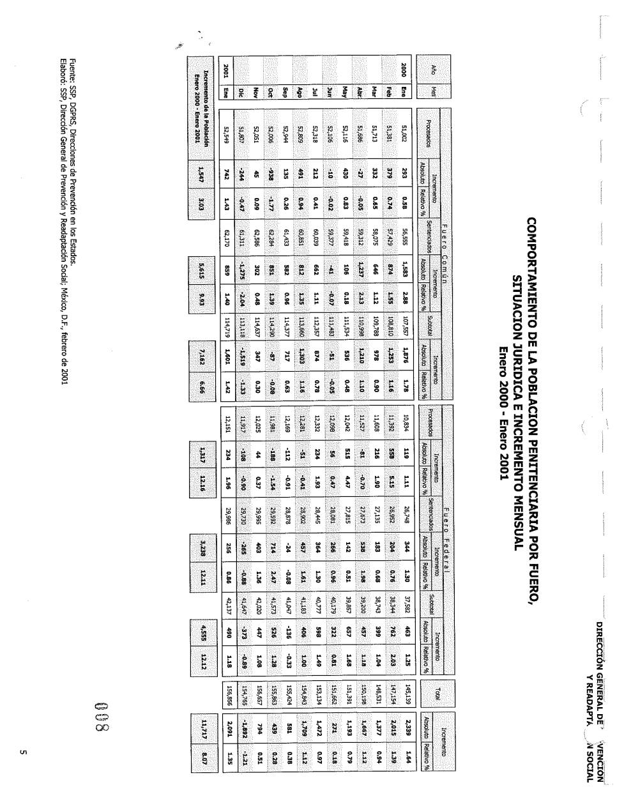

*Cuaderno de enero de 2001, tabla "Comportamiento de la población penitenciaria por fuero, situación jurídica e incremento mensual". Así viene: una fotocopia escaneada, acostada, con el sello de la página ("008") y sombreado de puntos sobre las cifras.*

- `pdftotext` y pdfplumber devuelven **cero caracteres**: cada página es una imagen de 1696 × 2176 px. Hay que leerla con OCR.
- La hoja viene **acostada** en 2001–2003 y derecha en 2004–2005; en 2002, además, **chueca y combada**. Por eso los renglones se trazan de izquierda a derecha y no por una altura fija.
- El sombreado de puntos confunde al OCR. Se borra con un desenfoque leve antes de leer.
- En el OCR, "Ene" sale a veces como "unc". Los meses se asignan por el orden del renglón, no por el texto.
- **Cómo se valida sin el PDF digital:** en cada renglón, procesados + sentenciados = subtotal de cada fuero, y común + federal = total. Si un solo dígito se lee mal, la suma no cuadra y el cuaderno falla en voz alta. Así se extrajeron 2000‑01 a 2005‑01 a nivel nacional (`ocr13.py`, §16).

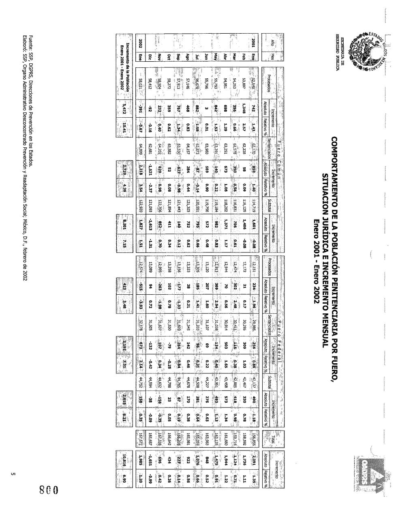

*Enero de 2002: la misma tabla, con otra inclinación y otro escaneo.*

### 2006–2013: hay texto, pero acomodado para el ojo

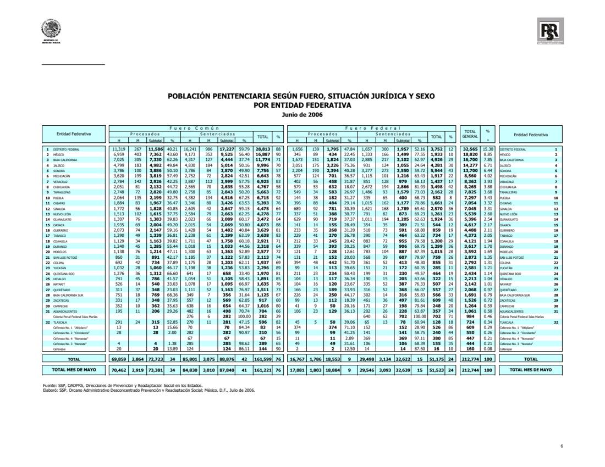

*Junio de 2006, "Población penitenciaria según fuero, situación jurídica y sexo por entidad federativa".*

- Las entidades **no van en orden alfabético sino por tamaño** (Distrito Federal, México, Baja California…), y el nombre se repite a la derecha de las cifras.
- Los centros federales (Islas Marías, CEFERESO 1–4, CEFEREPSI) van mezclados al final, sin renglón de grupo, y hay celdas vacías.
- Hay dos renglones de total: el del mes y el del **mes anterior** ("TOTAL MES DE MAYO"). Si se toma el segundo por error, la cifra de todo el mes sale corrida.
- La primera versión del extractor leía las filas intercaladas. Se resolvió leyendo cada palabra con sus coordenadas y armando las columnas por el borde derecho de las cifras.

### 2017–2026: hay texto, pero las celdas vacías mueven las cifras

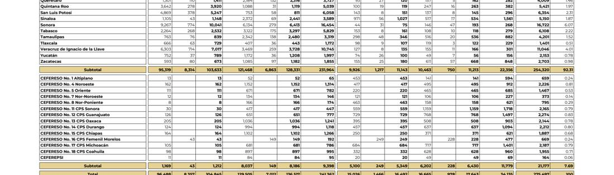

*Agosto de 2026: en los CEFERESO varoniles la columna de mujeres viene vacía, y en los femeniles la de hombres.*

Con `pdftotext -layout` (la herramienta usual para sacar tablas de PDFs) el texto de esas mismas filas sale así:

```
CEFERESO No. 4 Noroeste                                                                         2,226
CEFERESO No. 5 Oriente                             2,221                         22         17     1,467
CEFERESO No. 7 Nor-Noroeste
```

La cifra **2,226** (el total del CEFERESO 4) cae en la columna equivocada. El 2,221 de la fila de abajo es en realidad una cifra de otra fila, y el CEFERESO 7 se queda sin números. Una base armada así habría tenido errores silenciosos en todos los centros con alguna celda vacía. Por eso el extractor no usa `pdftotext`:
- lee cada palabra con sus coordenadas (pdfplumber);
- agrupa las columnas por el borde derecho de las cifras;
- y si no salen exactamente las columnas esperadas para esa época, **se detiene en vez de adivinar**.

### Y además

- **Jun–ago 2019:** el PDF publicado tiene 1–2 páginas y ninguna tabla (§14).
- **Dic‑2003:** la liga de gob.mx apunta al cuaderno de dic‑2023.
- **Abr‑2017:** el total impreso trae cifras pegadas ("111,75664.98386").
- **Nayarit, may–jun 2012:** el renglón estatal no coincide con la suma de sus propios centros.
- Variantes de columnas casi cada pocos años: % después de cada subtotal (ene–jun 2017), % solo tras procesados (2020–2021), sin columna TOTAL (2021‑02), tablas partidas en dos hojas (2007, 2020–2021) y páginas a otra escala (2012‑04).

Todo esto lo detectan los chequeos de §6. Un mes que no cuadra queda marcado en `data/processed/validacion.csv`; nunca se descarta en silencio.

