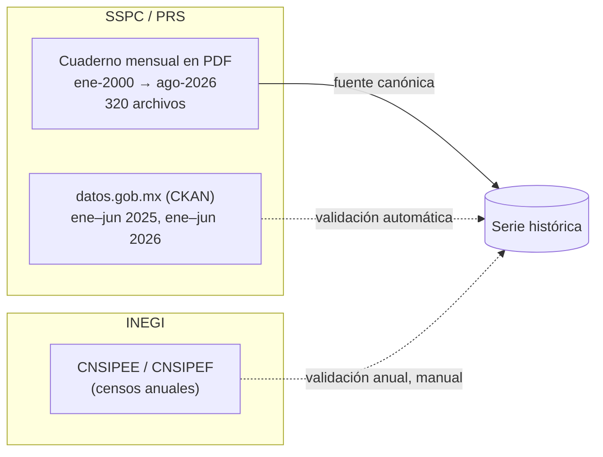
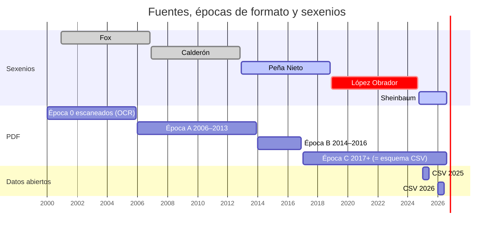
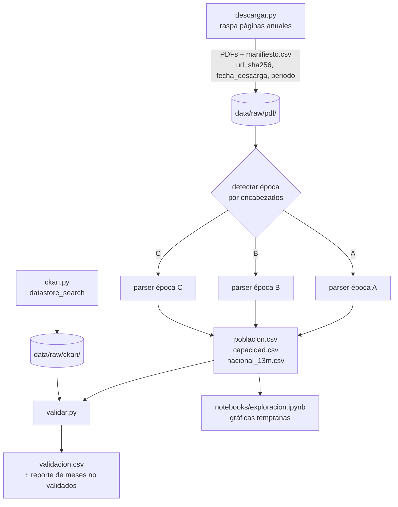
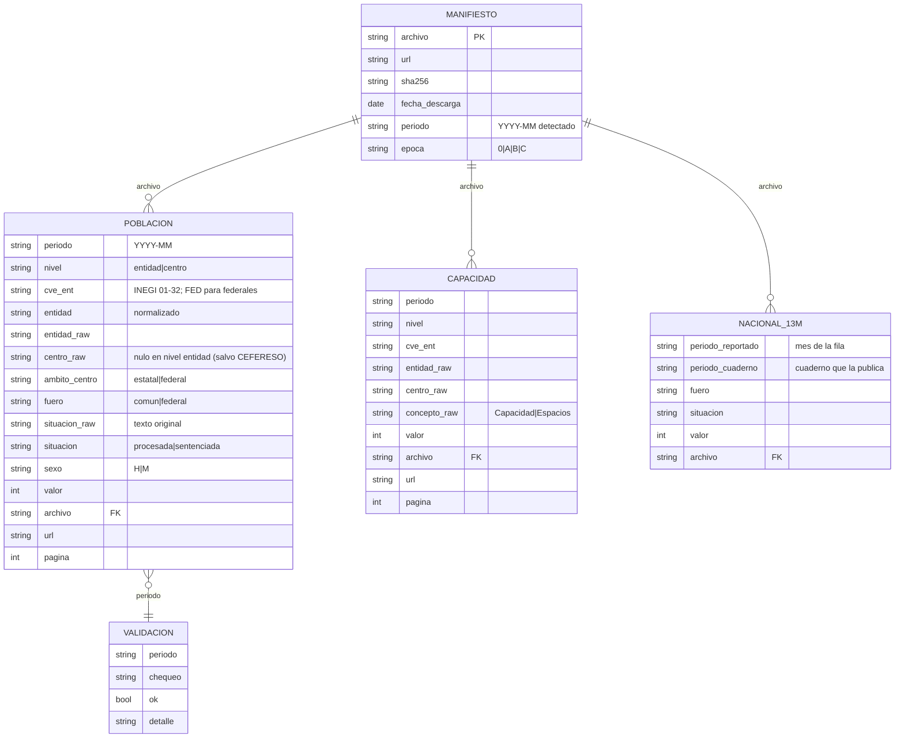
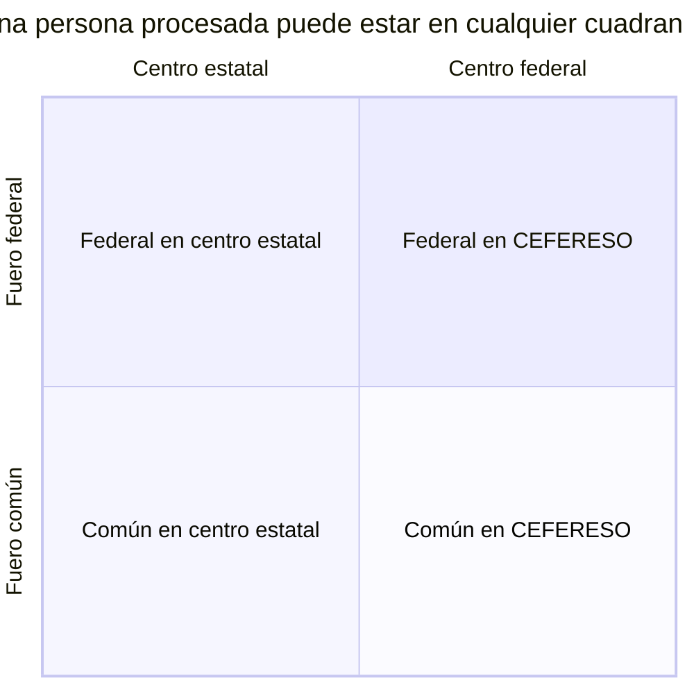
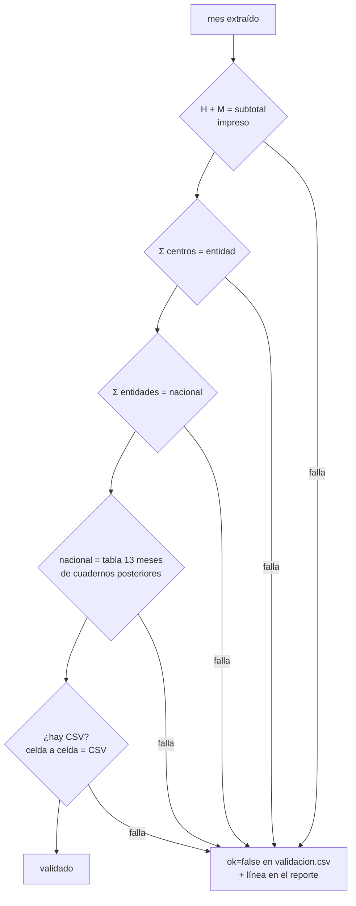
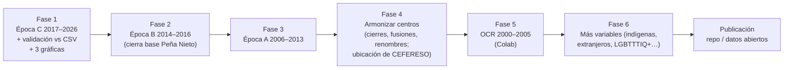

# Cuaderno penitenciario: serie histórica

Base de datos mensual, reproducible y validada, construida a partir del **Cuaderno Mensual de Información Estadística Penitenciaria Nacional** que publica la Secretaría de Seguridad y Protección Ciudadana (SSPC), a través de Prevención y Readaptación Social (PRS). La fuente son los PDF (2000‑2026); los datos abiertos de datos.gob.mx sirven para validar.

**Pregunta central.** ¿Cómo ha evolucionado el número de **personas procesadas, es decir, privadas de la libertad sin sentencia**? Primero se mira el sexenio de López Obrador comparado con el de Peña Nieto; después, el resto de la historia disponible (2006 a la fecha y, más adelante, desde 2000).

> Estado: **diseño acordado y nada implementado todavía**. Este README es la especificación. Las decisiones están en [§10](#10-registro-de-decisiones).

---

## Índice

1. [Fuentes](#1-fuentes)
2. [Cobertura y épocas de formato](#2-cobertura-y-épocas-de-formato)
3. [Arquitectura del pipeline](#3-arquitectura-del-pipeline)
4. [Modelo de datos](#4-modelo-de-datos)
5. [Conceptos y armonización](#5-conceptos-y-armonización)
6. [Validación](#6-validación)
7. [Periodos de análisis e hitos](#7-periodos-de-análisis-e-hitos)
8. [Gráficas tempranas](#8-gráficas-tempranas)
9. [Estructura del repositorio y entorno](#9-estructura-del-repositorio-y-entorno)
10. [Registro de decisiones](#10-registro-de-decisiones)
11. [Hoja de ruta](#11-hoja-de-ruta)
12. [Trampas conocidas](#12-trampas-conocidas)
13. [Glosario](#13-glosario)

---

## 1. Fuentes



### 1.1 PDFs (fuente canónica)

- Página índice: <https://www.gob.mx/prevencionyreinsercion/documentos/cuaderno-mensual-de-informacion-estadistica-penitenciaria-nacional-359620?idiom=es>
- La página índice enlaza una página por año o grupo de años: `…/cuaderno-mensual-de-informacion-estadistica-penitenciaria-nacional-{2026,2025,2024,2023,2017-2019,2015-2016,2013-2014,2012,…,2000}`. La página **sin sufijo** corresponde a 2020‑2022.
- Los archivos viven en `https://www.gob.mx/cms/uploads/attachment/file/<id>/<nombre>.pdf`. Los `<id>` **no son secuenciales**, así que hay que obtener los enlaces de cada página anual.
- Basta `curl` con un User‑Agent de navegador.
- Nombres irregulares que el descargador tiene que aceptar: `2000_01_CE.pdf` (2000‑2005), `CE_YYYY_MM.pdf`, `CE_2020_ENERO.pdf`, `CE_2020_SEPT.pdf`, `CE_10_2021.pdf`, `CE_12_2019.pdf`, `CUADERNO_ESTAD_STICO_SEPTIEMBRE_2025.pdf` y extensión `.PDF` (2007‑2008). **El periodo se toma de la página y del texto del PDF, no del nombre del archivo.**
- **Hueco conocido: dic‑2003.** La página de 2003 enlaza por error `CE_2023_12.pdf` (file id 902713).

### 1.2 Datos abiertos (validación)

- Organización `prs` en datos.gob.mx. Hay 19 datasets.
- API CKAN:
  - `https://www.datos.gob.mx/api/3/action/package_search?fq=organization:prs&rows=200`
  - `https://www.datos.gob.mx/api/3/action/datastore_search?resource_id=<id>&limit=1000`
- **Requiere un User‑Agent de navegador.** Sin él, Akamai responde 403.
- Los enlaces CSV directos (`repodatos.atdt.gob.mx/api_update/prs/...`) **responden 403** siempre. Hay que usar `datastore_search`.

| Serie | Meses | Recursos | Notas |
|---|---|---|---|
| Información estadística penitenciaria nacional (mes, 2025) | ene–jun 2025 | 31 CSV | archivos `NN_<tabla>_<mes>25.csv`; `fecha` = fecha de corte |
| Población penitenciaria vulnerable y de origen extranjero (mes, 2025) | ene–jun 2025 | 21 CSV | fuera del alcance de la fase 1 |
| Cuaderno Mensual Estadístico Penitenciario (mes, 2026) | ene–jun 2026 | 52–54 CSV | tablas extra (indígenas, LGBTTTIQ+, extranjeros, discapacidad…); `fecha` = **fecha de carga**, no de corte |

Las tablas que interesan tienen los mismos nombres de columna en 2025 y 2026:

| Recurso | Nivel | Contenido |
|---|---|---|
| `fue_sjur_sex_ent` | entidad (32 estados + 14 CEFERESO = 46 filas) | fuero × procesadas/sentenciadas × hombres/mujeres. En 2026 aparece mal titulado como "ingresos y egresos". |
| `fue_sjur_sex_centro1` | centro (~275 filas) | `estado`, `centro`, `espacios`, sobrepoblación, fuero × situación × sexo |
| `sobrepob_ent` | entidad | `numero_centros`, `espacios`, `poblacion`, sobrepoblación |
| `fue_sjur_var_mensual` | nacional, últimos 13 meses | procesadas/sentenciadas por fuero y su variación |

La copia local de los metadatos y de muestras de `datastore_search` está en `data/raw/ckan/`.

### 1.3 INEGI (validación anual)

- CNSIPEE, centros estatales: <https://www.inegi.org.mx/programas/cnsipee/>
- CNSIPEF, centros federales: <https://www.inegi.org.mx/contenidos/programas/cnsipef/2025/doc/cnsipef_2025_m2.pdf>
- Informes CTEISP del SNIEG, que usan el Cuaderno para sus Indicadores Clave: <https://www.snieg.mx/Documentos/Gobierno/Inf_semestral/2023/inf_cte_isipe2023.pdf>

No se encontró ninguna compilación previa de esta serie (GitHub, México Evalúa, Documenta, Asilegal).

---

## 2. Cobertura y épocas de formato



| Época | Años | Texto | Rasgos | Fase |
|---|---|---|---|---|
| **0** | 2000‑2005 | **escaneado, sin capa de texto** | requiere OCR | 5 (posible uso de Colab con GPU) |
| **A** | 2006‑2013 (43‑54 pp.) | sí | tabla por entidad "según fuero, situación jurídica y sexo" impresa en **dos bloques lado a lado**, así que las filas se intercalan al extraer. Ya hay tablas por centro ("Capacidad, sobrepoblación y población… por entidad federativa y centro"). Habla de "Internos" y "Procesados". | 3 |
| **B** | 2014‑2016 (60 pp.) | sí | mismo contenido; dice "institución penitenciaria" | 2 |
| **C** | 2017/2019‑2026 | sí | "Población privada de la libertad", "Personas procesadas", "Espacios". Tabla de origen por cada CEFERESO. Su estructura equivale a los CSV de 2026. | 1 |

Todas las épocas traen fuero común/federal, sexo y procesados/sentenciados. Todas incluyen una **tabla nacional de 13 meses**, de modo que cada cuaderno sirve para revisar los 12 anteriores.

Los límites entre épocas (2013/2014, 2016/2017) son aproximados. El parser debe **detectar la época por el texto** (encabezados), no por el año.

---

## 3. Arquitectura del pipeline



Principios:

- **Un solo extractor por época, aplicado a todos los meses.** No hay un pipeline aparte para los CSV: los CSV solo validan.
- **pdfplumber por coordenadas**, no `pdftotext -layout`. Este último **desalinea las celdas vacías**: en el cuaderno de ago‑2026 los CEFERESO sin mujeres "corren" sus cifras a otra columna. `pdftotext` sigue sirviendo para *buscar* páginas y encabezados.
- Los nombres de entidades y centros **se guardan en crudo**. La armonización de centros es una fase posterior.
- El proceso es idempotente: volver a correrlo sobre los mismos PDFs produce exactamente los mismos CSV.
- Actualización mensual: se corre `descargar.py` y el resto a mano cuando sale un cuaderno nuevo. No hay automatización por ahora.

---

## 4. Modelo de datos

Formato **largo**. **No se guardan totales**: se calculan, y se usan para validar.



Notas:

- `url` es la URL del PDF de origen, repetida en cada fila a propósito, para que cualquier cifra se pueda rastrear sin hacer joins.
- **Centros federales.** En `nivel=entidad`, cada CEFERESO es una fila con `cve_ent=FED`, `entidad="Centros federales"`, `ambito_centro=federal` y `centro_raw=<nombre>`. Así lo publica la fuente. Los CEFERESO **no se reparten por estado** porque su naturaleza es distinta.
- **Celdas vacías.** Una celda vacía en la fuente (por ejemplo, mujeres en un centro varonil) **no se escribe como fila**. Una fila con `valor=0` significa que la fuente publicó un 0.
- `nacional_13m` se guarda tal como lo publica cada cuaderno, incluso duplicado, para que sirva de testigo: un mismo mes aparece en 13 cuadernos.

---

## 5. Conceptos y armonización

### 5.1 Fuero vs. ámbito del centro (dos dimensiones distintas)



- `fuero` describe el delito o la autoridad que procesa.
- `ambito_centro` describe quién administra la prisión.
- En los centros estatales hay personas del fuero federal (por ejemplo, el CRS para Varones de Aguascalientes, jun‑2026: 106 procesados federales), y en los CEFERESO hay personas del fuero común.
- **"Procesados federales" es ambiguo.** Cada gráfica tiene que decir qué dimensión usa.

### 5.2 Situación jurídica

- La fuente usa "procesados/procesadas" y "sentenciados/sentenciadas". La expresión "sin sentencia" no aparece en ninguna edición revisada.
- `situacion_raw` guarda el texto tal cual. `situacion ∈ {procesada, sentenciada}` es la armonizada.
- En este proyecto, **sin sentencia = `situacion == "procesada"`**.
- La tabla de equivalencias se documenta en el código del parser. Cualquier etiqueta nueva **hace fallar** la extracción en lugar de clasificarse en silencio.

### 5.3 Capacidad

- Antes de 2017 se llama "Capacidad"; después, "Espacios". Se guarda `concepto_raw` y se tratan como el mismo concepto.
- La sobrepoblación **se calcula, no se copia**: población − espacios, y (población − espacios) / espacios.
- Motivo: los CSV cambian de unidad entre 2025 (fracción, 0.2476) y 2026 (porcentaje, 39).

### 5.4 Entidades

- `cve_ent` sigue el catálogo INEGI.
- `entidad_raw` conserva la grafía original ("Estado de Mexico" o "Estado de México", "Distrito Federal" o "Ciudad de México").

---

## 6. Validación

Los meses que no pasan **se guardan, se marcan y se reportan**. Nunca se descartan en silencio. Una corrección manual solo se acepta con una nota que diga por qué.



| Chequeo | Aplica a | Tolerancia |
|---|---|---|
| `suma_sexo` | todas las filas con subtotal impreso | 0 |
| `centros_vs_entidad` | meses con tabla por centro | 0; cualquier diferencia se reporta |
| `entidades_vs_nacional` | todos | 0 |
| `nacional_vs_13m` | todos los meses que aparezcan en un cuaderno posterior | 0; las revisiones retroactivas se reportan aparte |
| `pdf_vs_csv` | ene–jun 2025, ene–jun 2026 | 0 |
| `inegi_anual` | cortes anuales | manual, solo de referencia (fecha de corte distinta) |

---

## 7. Periodos de análisis e hitos

| Periodo | Desde | Hasta | Rol |
|---|---|---|---|
| Calderón | 2006‑12 | 2012‑11 | contexto histórico |
| **Peña Nieto** | **2012‑12** | **2018‑11** | **línea de base de comparación** (sexenio completo) |
| **López Obrador** | **2018‑12** | **2024‑09** | **núcleo de la historia** |
| Sheinbaum | 2024‑10 | en curso | continuidad |

Hitos que se marcan **explícitamente** en las gráficas. Las fechas deben verificarse en el DOF antes de publicar.

| Fecha | Hito | Por qué importa |
|---|---|---|
| 2008‑06 | Reforma constitucional penal (sistema acusatorio) | inicia la transición |
| **2016‑06** | **Sistema Penal Acusatorio vigente en todo el país** | **corte metodológico dentro del sexenio de Peña Nieto**: antes de esta fecha, buena parte de los procesados viene del sistema mixto. La comparación contra AMLO tiene que mostrarlo. |
| 2019‑04 | Reforma al art. 19: se amplía el catálogo de prisión preventiva oficiosa | hipótesis central del aumento de procesados |
| 2019 | Cierre del complejo Islas Marías | cambia el conjunto de CEFERESO |
| 2020‑04 | Ley de Amnistía y COVID‑19 | posibles caídas o choques |
| 2024‑12 | Nueva ampliación de la prisión preventiva oficiosa | relevante para el periodo de Sheinbaum |

---

## 8. Gráficas tempranas

Se hacen en un notebook con matplotlib. Cuando la historia esté armada se pasa a una página interactiva.

1. **Procesados nacionales por mes**, en número absoluto y como % de la población total, separados por fuero. Incluye bandas de sexenio y líneas en los hitos de §7.
2. **% de procesados por entidad**, como heatmap entidad × mes o small multiples. Los centros federales van como su propia "entidad".
3. **CEFERESO**: procesados por centro a lo largo del tiempo, con nombres sin armonizar.

---

## 9. Estructura del repositorio y entorno

```
cuaderno_pen/
├── README.md
├── .gitignore              # excluye data/raw/
├── descargar.py            # páginas anuales → PDFs + manifiesto
├── extraer.py              # PDFs → poblacion/capacidad/nacional_13m (un parser por época)
├── ckan.py                 # datastore_search → data/raw/ckan/
├── validar.py              # chequeos de §6 → validacion.csv
├── notebooks/
│   └── exploracion.ipynb
└── data/
    ├── raw/                # NO versionado (~1 GB de PDFs)
    │   ├── pdf/
    │   ├── ckan/
    │   ├── muestras/       # 12 PDFs de muestra + .txt (de exploración)
    │   └── manifiesto.csv
    └── processed/          # versionado: CSV pequeños
        ├── poblacion.csv
        ├── capacidad.csv
        ├── nacional_13m.csv
        └── validacion.csv
```

Los scripts se crean al implementarse. No se crean archivos ni carpetas vacíos por adelantado.

**Entorno:** se crea un conda env propio, `cuaderno_pen`, con `pdfplumber`, `pandas`, `matplotlib`, `requests` y `jupyter`. No se reutiliza `votaciones_corte`, para no romper otro proyecto. `pdftotext` (mingw) ya está instalado.

```bash
conda create -n cuaderno_pen -c conda-forge python=3.12 pdfplumber pandas matplotlib requests jupyter
```

**Colab:** no hace falta para las fases 1‑4, porque la extracción local tarda minutos. Se reserva para el OCR de 2000‑2005.

---

## 10. Registro de decisiones

| # | Tema | Decisión | Motivo |
|---|---|---|---|
| D1 | Sexenios | AMLO como núcleo, Peña Nieto completo como base y Sheinbaum como continuidad | comparar sexenios completos; marcar el corte de jun‑2016 |
| D2 | Alcance fase 1 | situación jurídica × fuero × sexo + capacidad | lo mínimo para la historia. **Todas las variables** del cuaderno quedan para después y el esquema largo lo permite. |
| D3 | Nivel geográfico | **entidad y centro** | los CEFERESO solo se ven bien por centro; los nombres de centro van en crudo |
| D4 | Frecuencia | mensual | ve choques puntuales; el costo marginal por mes es casi cero |
| D5 | "Sin sentencia" | `situacion_raw` + `situacion` armonizada | trazabilidad ante cuestionamientos |
| D6 | Producto | base + script reproducible + gráficas tempranas | — |
| D7 | Herramientas | Python; pdfplumber en un env propio | `pdftotext -layout` desalinea celdas vacías |
| D8 | Fuente canónica | **PDF en todos los meses**; CSV solo valida | un solo pipeline; cubre jul–dic 2025 y los meses sin CSV |
| D9 | Inicio | 2006; 2000‑2005 (OCR) después | todo lo de 2006 en adelante es texto |
| D10 | Centros federales | entidad aparte (`FED`), sin repartir por estado | naturaleza distinta |
| D11 | Línea de base | sexenio completo de Peña Nieto, con el corte de 2016‑06 explícito | comparación completa sin ocultar el cambio de sistema |
| D12 | Fuero vs. ámbito | dos columnas | hay presos comunes en centros federales y federales en centros estatales |
| D13 | Esquema | formato largo, sin totales; con `archivo`, `url` y `pagina` | trazabilidad y tolerancia a cambios de formato |
| D14 | Meses que fallan | se guardan, se marcan y se reportan | un hueco es peor que un dato marcado |
| D15 | Orden | época C → B → A → OCR | gráficas tempranas del núcleo; validable contra CSV |
| D16 | Gráficas | notebook primero, página interactiva después | — |
| D17 | Repo | git; `data/raw` fuera de git con manifiesto `sha256`; salidas en CSV | reproducibilidad sin cargar 1 GB en git |

---

## 11. Hoja de ruta



Para la base de Peña Nieto (dic‑2012 a nov‑2018) se necesitan las épocas A (2012‑2013), B (2014‑2016) y C (2017‑2018). La comparación completa contra AMLO queda lista al terminar la fase 3. Las fases 1 y 2 ya permiten comparar contra el tramo dic‑2013 a nov‑2018.

---

## 12. Trampas conocidas

- **Encoding.** Los `.txt` de `pdftotext` salen en Latin‑1 o cp1252: "Michoac�n". Hay que leer con el encoding correcto o pasar `-enc UTF-8`.
- **Columnas desalineadas.** `pdftotext -layout` desalinea las celdas vacías (CEFERESO varoniles o femeniles). Por eso se usa pdfplumber.
- **Bloques lado a lado.** En la época A las filas de dos bloques se intercalan. Hay que recortar por coordenadas (`page.crop`) cada mitad.
- **Fechas en los CSV.** En 2026, `fecha` es el timestamp de carga. El periodo se toma del nombre del dataset.
- **Unidades en los CSV.** `sobrepoblacion_relativa` viene como fracción en 2025 y como % en 2026. Los `_prct` son strings en 2025.
- **Recurso mal titulado.** En 2026, `fue_sjur_sex_ent` aparece titulado como "ingresos y egresos".
- **Revisiones retroactivas.** La tabla de 13 meses puede corregir meses anteriores. Las diferencias se reportan, no se "arreglan".
- **Hueco de dic‑2003** (época 0, no afecta a las fases 1‑4).
- **Conjunto de CEFERESO cambiante.** Hubo cierres (Islas Marías, entre otros) y aperturas de CPS privados desde ~2012. Por eso `centro_raw` va sin armonizar.

---

## 13. Glosario

| Término | Significado |
|---|---|
| Procesada/o | persona privada de la libertad **sin sentencia** (prisión preventiva) |
| Sentenciada/o | persona con sentencia condenatoria |
| Fuero común / federal | competencia estatal o federal sobre el delito |
| CEFERESO | Centro Federal de Readaptación Social |
| CPS | Centro Penitenciario Federal operado bajo contrato de prestación de servicios (privado) |
| CRS / CERESO | centro (estatal) de reinserción o readaptación social |
| PPO | prisión preventiva oficiosa (art. 19 constitucional) |
| SJPA / SPA | sistema de justicia penal acusatorio |
| PRS | Prevención y Readaptación Social (órgano de la SSPC que publica el cuaderno) |
